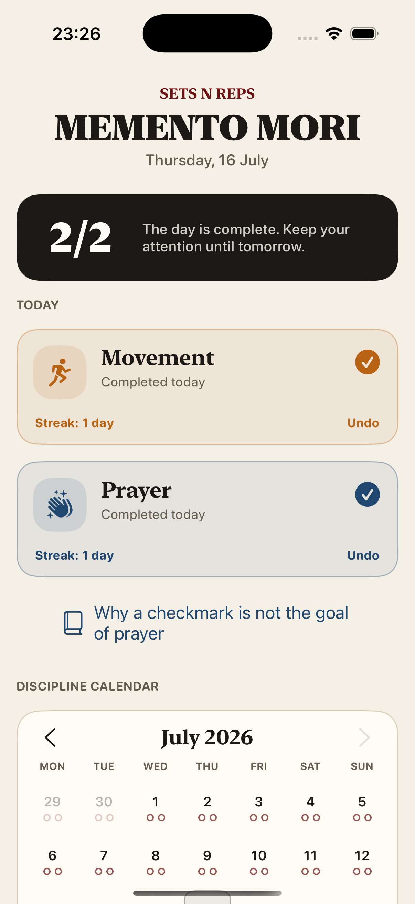
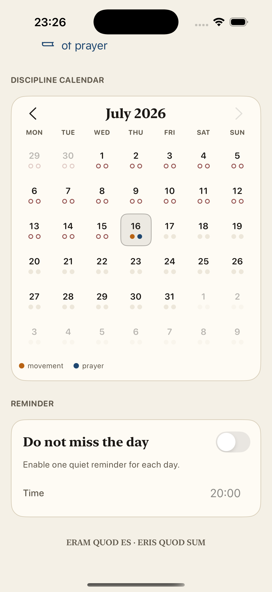

# Move & Pray

Простое iOS-приложение для ежедневной дисциплины тела и души.

Пользователь отмечает два факта за день: движение и молитву. Move & Pray сохраняет историю, показывает серии выполнений и напоминает завершить день без пропусков.

Bundle ID: `com.andreichev.moveandpray`.

> Eram quod es · eris quod sum  
> Я был тем, кто ты есть; ты станешь тем, кто я есть.

## Скриншоты

<table>
  <tr>
    <td align="center"><strong>Главный экран</strong></td>
    <td align="center"><strong>Календарь и напоминания</strong></td>
  </tr>
  <tr>
    <td></td>
    <td></td>
  </tr>
  <tr>
    <td align="center"><strong>Пояснение о молитве</strong></td>
    <td align="center"><strong>Launch screen</strong></td>
  </tr>
  <tr>
    <td></td>
    <td></td>
  </tr>
</table>

## Возможности

- Ежедневные отметки движения и молитвы.
- Календарь со статусом каждого дня.
- Подсчёт непрерывных серий.
- Настраиваемые локальные уведомления.
- Автоматическое снятие напоминания после выполнения обеих отметок.
- Пояснение о том, почему молитва не должна становиться механическим счётчиком.
- Ссылка на наставления святителя Феофана Затворника.
- Английская и русская локализации, включая даты, уведомления и accessibility.
- Локальное хранение данных без регистрации и стороннего сервера.
- Ссылки на политику конфиденциальности и поддержку внутри приложения.

## Архитектура

Приложение написано на UIKit и следует архитектуре из [`context/IOS-ARCHITECTURE.md`](context/IOS-ARCHITECTURE.md):

```text
View → Controller → Interactor → Controller → View
```

- `View` создаёт и отображает UI, сообщая только о намерениях пользователя.
- `Controller` управляет сценарием экрана и presentation-решениями.
- `Interactor` выполняет прикладные сценарии и координирует сервисы.
- `Services` отвечают за локальные данные и уведомления.

Основная структура проекта:

```text
MoveAndPray/
├── MainFiles/   # AppDelegate, SceneDelegate
├── Controllers/ # Controller, View, Interactor и display models
├── Services/    # Хранение отметок и локальные уведомления
├── Helpers/     # Календарь, тема и локализация
└── Resources/   # Assets, launch screen, Info.plist и локализации
```

## Требования

- iOS 16.6+
- Xcode 26+ для отправки в App Store
- Swift 5

Сторонние библиотеки не используются.

## Запуск

Откройте `MoveAndPray.xcodeproj` в Xcode, выберите iPhone Simulator или физическое устройство и запустите схему `MoveAndPray`.

Сборка из терминала:

```sh
xcodebuild \
  -project MoveAndPray.xcodeproj \
  -scheme MoveAndPray \
  -sdk iphonesimulator \
  -destination 'generic/platform=iOS Simulator' \
  CODE_SIGNING_ALLOWED=NO \
  build
```

## Данные и уведомления

Отметки, настройки напоминаний и факт ознакомления с пояснением о молитве сохраняются локально в `UserDefaults`. Разрешение на уведомления запрашивается только после включения напоминаний пользователем.

Локальные напоминания планируются на ближайшие 32 дня и обновляются при открытии приложения и изменении отметок или настроек. Если не открывать приложение дольше этого срока, напоминания закончатся.

`Resources/PrivacyInfo.xcprivacy` декларирует использование `UserDefaults` с причиной `CA92.1`, отсутствие отслеживания и сбора данных. В `Info.plist` задано `ITSAppUsesNonExemptEncryption = false`.

После публикации сайта политика конфиденциальности доступна по адресу https://andreichev.github.io/MoveAndPray/privacy/, поддержка — https://andreichev.github.io/MoveAndPray/support/.

## Сайт на GitHub Pages

Статические страницы находятся в `docs/` того же репозитория: главная, поддержка и политика конфиденциальности. Они не требуют сборщика или установки зависимостей. Внешние шрифты, аналитика и скрипты не используются.

Все три страницы доступны на русском и английском. Английские версии находятся в корне сайта, русские — в `/ru/`, `/ru/support/` и `/ru/privacy/`. Переключатель «Русский / English» открывает ту же страницу на другом языке; навигация сохраняет выбранный язык. Из приложения ссылки открываются на языке его интерфейса.

`docs/favicon.png` и `docs/apple-touch-icon.png` подготовлены из иконки приложения для вкладки браузера и домашнего экрана.

После загрузки изменений в репозиторий `andreichev/MoveAndPray`:

1. Открыть **Settings → Pages → Build and deployment**.
2. Выбрать **Deploy from a branch**, ветку **main** и папку **/docs**.
3. Нажать **Save** и дождаться успешного завершения публикации.
4. Проверить главную страницу, `/support/` и `/privacy/` по адресу `https://andreichev.github.io/MoveAndPray/`.

На GitHub Free Pages доступен для публичных репозиториев. Для приватного личного репозитория нужен GitHub Pro. Видимость репозитория и настройки Pages меняются вручную; они не изменяются локальной подготовкой файлов. Подробнее: [настройка источника GitHub Pages](https://docs.github.com/en/pages/getting-started-with-github-pages/configuring-a-publishing-source-for-your-github-pages-site).

Публичный контакт поддержки и вопросов о приватности: [andreichev.m@mail.ru](mailto:andreichev.m@mail.ru). Перед отправкой приложения в App Store страницы должны быть опубликованы. Адреса внутри приложения уже рассчитаны на указанный сайт Pages.

Материал о внимательной молитве: [святитель Феофан Затворник — «О молитве»](https://azbyka.ru/otechnik/Feofan_Zatvornik/o-molitve/).
